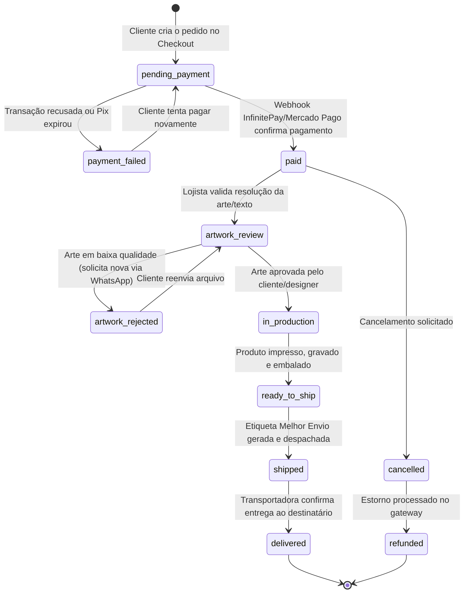

# BLUEPRINT ARQUITETURAL & FUNCIONAL: SAAS MULTI-TENANT DE PERSONALIZADOS
**Projeto Base:** JESTEIN Personalizados / Cubo Digital  
**Destino:** Plataforma SaaS E-commerce Multi-Tenant de Alta Conversão  
**Versão:** 1.0.0  
**Data:** 18 de Novembro de 2026  

---

## 1. VISÃO GERAL & PRINCÍPIOS ARQUITETURAIS

A nova plataforma SaaS proprietária tem como objetivo fornecer um ambiente de comércio eletrônico multi-tenant focado no segmento de **brindes corporativos, produtos personalizados e e-commerce de impressão sob demanda (Print-on-Demand & B2B)**.

### Pilares da Arquitetura SaaS
1. **Isolamento Lógico Estrito (Multi-Tenancy):**
   - Todas as entidades de catálogo, clientes, pedidos, configurações e integrações são segregadas logicamente por chave primária de inquilino (`tenant_id`).
   - Suporte nativo a subdomínios (`loja.plataforma.com.br`) e domínios personalizados (`www.jesteinpersonalizados.com.br`) com roteamento automático no edge (Edge Reverse Proxy / Cloudflare for SaaS).
2. **Alta Performance & Resiliência:**
   - Stack moderna desacoplada (Frontend Headless Next.js/React + API REST/GraphQL NestJS/Node.js ou Go + PostgreSQL).
   - Zero dependência do stack WordPress/WooCommerce legado, preservando 100% da identidade visual Pop-Art/Comic, regras comerciais de atacado e usabilidade validada.
3. **Conversão Focada no Mercado Brasileiro:**
   - Checkout em etapa única (One-Page / Two-Step) otimizado com dados fiscais nacionais (CPF/CNPJ, CEP com preenchimento automático).
   - Meios de pagamento nativos: Pix instantâneo via InfinitePay / Mercado Pago e Cartão de Crédito com parcelamento em até 12x.
   - Cálculo de frete multi-transportadora via Melhor Envio com soma automática do prazo de produção industrial.

---

## 2. IDENTIDADE VISUAL & DESIGN SYSTEM (UI/UX)

A identidade visual é baseada na estética **Neo-Brutalista / Pop-Art / HQ**, combinando contrastes de alta visibilidade, bordas pretas sólidas, sombras duras sem difusão (*hard offset shadow*) e tipografia expressiva.

### 2.1. Tokens de Cores (Paleta Oficial)

| Nome do Token | Valor Hex | Função na Interface |
| :--- | :--- | :--- |
| `--color-brand-blue-dark` | `#0052B4` | Azul institucional primário, cabeçalho de destaque, botões secundários |
| `--color-brand-cyan` | `#00A8E8` | Ciano vibrante, detalhes gráficos, badges e ícones de confiança |
| `--color-accent-yellow` | `#FFD100` | Amarelo Pop-Art, chamadas principais de ação (CTA primário), preços e badges |
| `--color-accent-green` | `#7AC943` | Verde de conversão, badges "Recebendo Pedidos", confirmações de sucesso |
| `--color-accent-red` | `#D92027` | Vermelho de urgência, badges "HOT", "Oferta", "Mais Vendido" e alertas |
| `--color-brand-purple` | `#4B2683` | Roxo complementar de contraste para categorias especiais |
| `--color-ink-black` | `#111111` | Preto nanquim, textos principais, contornos rígidos e sombras duras |
| `--color-bg-light` | `#F4F7FA` | Fundo geral da aplicação e páginas públicas |
| `--color-surface-white`| `#FFFFFF` | Superfície de cards, modais e containers de produtos |
| `--color-border-subtle` | `#E2E8F0` | Linhas divisórias internas de baixa ênfase |
| `--color-text-muted` | `#555555` | Descrições secundárias, SKUs e notas de rodapé |

### 2.2. Bordas, Sombras e Raios Gráficos

- **Bordas Comic:**
  - Padrão: `2px solid #111111`
  - Espessa (Cards/Destaques): `3px solid #111111`
- **Sombras Rígidas (Hard Offset Shadows):**
  - Pequena: `2px 2px 0px #111111`
  - Padrão: `3px 3px 0px #111111`
  - Grande (Hover / Hero): `5px 5px 0px #111111`
  - Ativo (Clique): `1px 1px 0px #111111` com `translate(1px, 1px)`
- **Raios de Arredondamento:**
  - Pequeno: `4px`
  - Médio (Padrão de cards/botões): `8px`
  - Grande: `12px`
  - Pílula (Badges): `9999px`

### 2.3. Tipografia

- **Títulos e Headings (`--font-heading`):**  
  `'Montserrat', -apple-system, BlinkMacSystemFont, "Segoe UI", Roboto, sans-serif`  
  *Pesos:* 800 (Extra Bold) e 900 (Black).  
  *Características:* Caixa-alta (*uppercase*) em botões e badges, espaçamento entre letras ligeiramente compacto para títulos impactantes.
- **Corpo e Interface (`--font-body`):**  
  `'Inter', -apple-system, BlinkMacSystemFont, "Segoe UI", Roboto, sans-serif`  
  *Pesos:* 400 (Regular), 500 (Medium), 600 (Semi-Bold), 700 (Bold).  
  *Características:* Alta legibilidade em formulários de checkout e tabelas de preços.

### 2.4. Estilos de Botões & Badges

1. **Botão Primário (`.btn-primary`):**
   - Fundo: `#FFD100` (Amarelo) | Texto: `#111111` | Borda: `2px solid #111111` | Sombra: `3px 3px 0px #111111`
   - Hover: Fundo `#FFE033`, elevação com `translate(-2px, -2px)` e sombra `5px 5px 0px #111111`.
   - Uso: Botão de Compra ("Personalizar & Comprar"), Avançar Checkout, Adicionar ao Carrinho.
2. **Botão Secundário (`.btn-secondary`):**
   - Fundo: `#0052B4` (Azul Escuro) | Texto: `#FFFFFF` | Borda: `2px solid #111111`
   - Uso: Ações complementares ("Ver Catálogo Completo", "Filtrar").
3. **Botão Outline (`.btn-outline`):**
   - Fundo: `#FFFFFF` | Texto: `#111111` | Borda: `2px solid #111111`
   - Uso: Ações neutras, voltar etapas, detalhes.
4. **Botão WhatsApp / Atendimento (`.btn-whatsapp`):**
   - Fundo: `#25D366` | Texto: `#FFFFFF` | Borda: `2px solid #111111`
   - Uso: Atendimento comercial, solicitação de cotação B2B rápida.
5. **Badges Pop-Art:**
   - Variantes: Amarelo (`#FFD100`), Vermelho (`#D92027`), Verde (`#7AC943`), Azul (`#0052B4`).
   - Formato pílula com borda preta sólida de 2px e sombra de 2px.

---

## 3. COMPONENTES VISUAIS & ESTRUTURA DE TELAS

### 3.1. Cabeçalho & Navegação Global (Header)

```
┌──────────────────────────────────────────────────────────────────────────────────┐
│ TOPBAR: 🚚 Envio p/ todo Brasil • Descontos Progressivos    | 💬 WhatsApp | 📦 Rastreio │
├──────────────────────────────────────────────────────────────────────────────────┤
│ [ LOGO JESTEIN ]   [ 🔍 Buscar canecas, camisetas, squeezes... ]  [ 👤 Entrar ] [ 🛒 (3) ]│
├──────────────────────────────────────────────────────────────────────────────────┤
│ [≡ Todos os Produtos]  [Impressão Laser]  [Camisetas]  [Canecas]  [Kits] | [⚡ Atacado B2B]│
└──────────────────────────────────────────────────────────────────────────────────┘
```

1. **Topbar de Aviso:** Barra escura superior com mensagens rotativas de frete/benefícios e atalhos rápidos para rastreamento e atendimento.
2. **Header Principal Sticky:**
   - Logomarca da loja com redimensionamento proporcional.
   - Campo de busca inteligente com autocompletar e prévia de miniaturas.
   - Atalhos de autenticação/área do cliente e ícone de carrinho com contador reativo via WebSocket ou estado reativo local.
3. **Barra de Menus e Categorias (Menu do Topo de 2 Níveis):**
   - Suporte a itens pais com dropdown de 1 nível de profundidade (ex: *Impressão a Laser* -> *Canetas*).
   - Suporte a Badges em itens específicos ("HOT", "NOVO").
   - Botão de Ação Direta no Topo (CTA): Botão pulsante configurável com destino para WhatsApp comercial ou landing page B2B.

### 3.2. Página Inicial (Vitrine / Home Page)

1. **Hero Banner Principal:**
   - Estrutura em 2 colunas:
     - Esquerda: Badges de urgência/campanha, Título tripartido (Prefixo + Destaque estilizado + Sufixo), Descrição persuasiva, Botões de ação (Catálogo e WhatsApp) e checklist de benefícios com ícones de visto (*Check*).
     - Direita: Imagem de produto/campanha em perspectiva com efeito gráfico Pop-Art.
2. **Barra de 4 Pilares de Confiança (Features Bar):**
   - 1. *Fortaleça seu Relacionamento* (Brindes de alto impacto)
   - 2. *Divulgue sua Marca* (Presença constante)
   - 3. *Desconto Progressivo* (Compre mais e pague menos por unidade)
   - 4. *Envio para Todo o Brasil* (Logística rastreada)
3. **Grid de Categorias Populares:** Cards com imagem arredondada, contorno comic e contagem de itens.
4. **Vitrine de Produtos em Destaque:** Grid de 4 colunas com cards padronizados.
5. **Seção "Como Funciona a Personalização":** 4 passos explicativos (Escolha o Produto -> Envie Arte ou Texto -> Aprovação da Prévia -> Produção e Entrega).
6. **Card de Atendimento B2B Corporativo:** Bloco de alta conversão para pedidos em lote para empresas com link direto contextualizado para WhatsApp.

### 3.3. Página do Produto (Single Product)

```
┌─────────────────────────────────┬────────────────────────────────────────────────┐
│                                 │ Categoria / Breadcrumbs                        │
│                                 │ NOME DO PRODUTO PERSONALIZADO                  │
│                                 │ [Mais Vendido]                                 │
│                                 │ Preço Unitário Base: R$ 39,90                  │
│                                 ├────────────────────────────────────────────────┤
│       GALERIA DE IMAGENS        │ COMPRE MAIS E PAGUE MENOS (TABELA DE ATACADO)  │
│                                 │ [ 1 a 3 un. ] [ 4 a 35 un. ] [ 36+ un. ]       │
│                                 │   R$ 39,90      R$ 34,90       R$ 29,90        │
│                                 │                 (-12%)         (-25%)          │
│                                 ├────────────────────────────────────────────────┤
│                                 │ 🎨 PERSONALIZE SEU PRODUTO                     │
│                                 │ Nome ou Frase para Gravação:                   │
│                                 │ [_____________________________] (0/40 chars)   │
│                                 │                                                │
│                                 │ Envie sua Arte ou Logotipo:                    │
│                                 │ [ ⬆ Escolher Arquivo ] logotipo.svg (Remover) │
│                                 │ (PNG, JPG, SVG ou PDF - máx 10MB)             │
│                                 ├────────────────────────────────────────────────┤
│                                 │ Qtd: [ - | 50 | + ]  Total: R$ 1.495,00        │
│                                 │ [ 🛒 PERSONALIZAR & COMPRAR ]                   │
│                                 │ ⏱ Prazo adicional: +3 dias úteis de produção  │
│                                 ├────────────────────────────────────────────────┤
│                                 │ 🚚 Calcular Frete e Prazo: [ CEP ] [Calcular]  │
└─────────────────────────────────┴────────────────────────────────────────────────┘
```

Componentes exclusivos da página de produto:
- **Tabela de Atacado Dinâmica (`Wholesale Tiers Box`):** Badges interativos que se iluminam conforme a quantidade inserida no campo numérico muda, atualizando em tempo real o preço unitário e o desconto obtido.
- **Painel de Personalização:**
  - Campo de texto customizado com limite rígido de caracteres e contador reativo.
  - Upload assíncrono de arte/logo com validação de tipo MIME no frontend e backend, gerando um token seguro temporário antes do checkout.
- **Aviso de Prazo de Produção:** Selo visual informando os dias úteis adicionais necessários para manufatura/personalização antes do despacho.
- **Calculadora de Frete Integrada:** Consulta em tempo real via API da transportadora com soma do prazo de produção.

### 3.4. Carrinho de Compras (Cart)

- **Layout de 2 Colunas (~58% itens / ~42% resumo):**
  - Coluna Esquerda:
    - Lista de itens com thumbnail, título, atributos selecionados (ex: Tamanho P, M, G), detalhes de personalização (texto digitado e link/miniatura da arte enviada).
    - Botões intuitivos de ajuste de quantidade e remoção.
    - Campo para inserção de Cupom de Desconto.
  - Coluna Direita (Sticky Order Summary):
    - Subtotal dos produtos (com descontos de atacado já calculados).
    - Seletor de opções de frete calculadas.
    - Total final destacado em Amarelo Pop-Art.
    - Botão CTA largo "Finalizar Compra".

### 3.5. Checkout Otimizado para o Brasil

- **Formulário de 2 Colunas:**
  - Coluna 1 (Dados Pessoais e Fiscais):
    - Identificação: Alternador Pessoa Física (CPF) / Pessoa Jurídica (CNPJ + Razão Social + Inscrição Estadual).
    - Nome completo, e-mail para notificações e WhatsApp com máscara internacional `(DD) 9XXXX-XXXX`.
    - Endereço completo com busca automática por CEP (ViaCEP / Melhor Envio Postal Code API) preenchendo Logradouro, Bairro, Cidade e UF.
  - Coluna 2 (Resumo & Pagamento):
    - Resumo dos itens com miniaturas e dados de personalização.
    - Seletor de Métodos de Pagamento:
      1. **Pix (InfinitePay / Mercado Pago):** Geração imediata de QR Code e código Pix Copia-e-Cola com temporizador de expiração e confirmação via webhook em menos de 3 segundos.
      2. **Cartão de Crédito:** Campos tokenizados no client-side (PCI-DSS compliant), seleção de parcelamento de 1x a 12x com cálculo de juros/sem juros.
    - Botão final de compra com proteção contra duplo clique.

---

## 4. CATÁLOGO, PRECIFICAÇÃO & REGRAS DE NEGÓCIO

### 4.1. Estrutura do Catálogo

1. **Categorias Principais do Segmento:**
   - `canecas` (Canecas de cerâmica, polímero, mágicas, chopp)
   - `camisetas` (Camisetas personalizadas 100% algodão, dry-fit, polo)
   - `canetas` (Canetas metálicas gravadas a laser, plásticas corporativas)
   - `bolsas-e-ecobags` (Ecobags de algodão cru, sacolas promocionais)
   - `squeezes-e-garrafas` (Squeezes de alumínio, térmicas inox)
   - `kits-corporativos` (Kits de boas-vindas / onboarding para RH e eventos)
   - `impressao-a-laser` (Itens de metal, madeira e couro com gravação a laser)
2. **Produtos e Variações:**
   - **Produtos Simples:** Grande maioria dos brindes com personalização de arte/texto (canecas, squeezes, canetas).
   - **Produtos Variáveis:** Produtos que exigem opções físicas antes da personalização, como Camisetas (Atributo `Tamanho`: P, M, G, GG, XG).
   - **Pesos e Dimensões:** Todo produto possui obrigatoriamente `weight_grams`, `length_cm`, `width_cm` e `height_cm` cadastrados para a cubagem das transportadoras.

### 4.2. Motor de Precificação Progressiva de Atacado (Wholesale Engine)

O sistema de precificação não utiliza descontos percentuais simples; ele utiliza **faixas de quantidade mínima com preço unitário cravado**, incentivando a compra em volume por empresas e eventos.

- **Exemplo de Regra Comercial (Caneca de Cerâmica):**
  - Faixa 1 (1 a 3 unidades): R$ 39,90 / un. (Preço base)
  - Faixa 2 (4 a 35 unidades): R$ 34,90 / un. (12% OFF automático)
  - Faixa 3 (36+ unidades): R$ 29,90 / un. (25% OFF automático)
- **Algoritmo de Cálculo:**
  - O cálculo do preço unitário aplicável a cada item do carrinho é determinado pela soma de quantidades daquele produto (ou de suas variantes) presentes no pedido.
  - A fórmula é recalculada atômica e deterministicamente no backend a cada mutação do carrinho:
    $$\text{ItemSubtotal} = \text{Quantidade} \times \text{TierPrice}(\text{ProductID}, \text{QuantidadeTotal})$$

### 4.3. Regras de Personalização Industrial

Para cada produto do catálogo, o lojista configura:
1. `enable_text` (Booleano): Permite que o cliente digite uma frase/nome.
2. `text_label` (String): Rótulo do campo (ex: "Nome para gravação a laser").
3. `text_max_length` (Inteiro): Limite de caracteres permitidos (padrão: 40).
4. `enable_upload` (Booleano): Permite envio de arquivos pelo cliente.
5. `upload_max_mb` (Inteiro): Limite de tamanho por arquivo (padrão: 10 MB a 50 MB).
6. `allowed_formats` (Array): Extensões aceitas (`png`, `jpg`, `jpeg`, `svg`, `pdf`).
7. `production_lead_time_days` (Inteiro): Dias úteis necessários para produção.

### 4.4. Regras de Frete & Logística

1. **Cálculo de Prazo Total de Entrega:**
   $$\text{PrazoTotal (dias úteis)} = \max(\text{production\_lead\_time\_days dos itens}) + \text{PrazoTransportadora}$$
   Esse cálculo deve ser exibido com transparência máxima para o cliente:  
   *"Prazo de Entrega: 3 dias úteis de produção + 4 dias úteis de transporte = 7 dias úteis."*
2. **Integração com Melhor Envio:**
   - Envio das dimensões totais agrupadas dos itens (cubagem consolidada).
   - Retorno dinâmico das cotações das transportadoras credenciadas (Correios SEDEX/PAC, Jadlog .Package/.Com, Loggi, Azul Cargo).
3. **Regra de Frete Grátis por Tenant:**
   - Configurável por valor mínimo de pedido e faixa de CEPs/Estados atendidos.

### 4.5. Ciclo de Vida e Fluxo de Status do Pedido



---

## 5. JORNADA DO USUÁRIO & ESPECIFICAÇÃO DE TELAS

### 5.1. Loja Pública (Storefront)

| Tela | Rota | Principais Ações & Recursos |
| :--- | :--- | :--- |
| **Home Page** | `/` | Hero banner comercial, busca instantânea, categorias populares, destaques e card B2B. |
| **Catálogo / Categoria** | `/categoria/[slug]` | Filtros por categoria, ordenação por preço/popularidade, grid responsivo em 4 colunas. |
| **Página do Produto** | `/produto/[slug]` | Galeria, tabela dinâmica de atacado, personalizador de texto/arte, estimativa de frete. |
| **Carrinho** | `/carrinho` | Listagem com miniaturas da arte anexada, cupom de desconto, seletor de frete. |
| **Checkout** | `/checkout` | One-step com validação brasileira (CPF/CNPJ, CEP), seleção Pix ou Cartão 12x. |
| **Pedido Confirmado** | `/pedido/[id]/obrigado` | QR Code Pix dinâmico, código copia-e-cola, resumo do pedido e link para WhatsApp. |
| **Rastreio de Pedido** | `/rastreio` ou `/rastreio/[codigo]` | Linha do tempo em tempo real com eventos de produção e rastreio da transportadora. |
| **Área do Cliente** | `/minha-conta` | Histórico de pedidos, download de notas fiscais, gestão de endereços. |

### 5.2. Painel Administrativo do Lojista (Tenant Admin Portal)

| Módulo | Submódulos & Ações |
| :--- | :--- |
| **Dashboard** | Visão analítica de faturamento (GMV), pedidos por status, ticket médio, taxa de conversão Pix vs Cartão. |
| **Fila de Produção & Pedidos** | - Visualização em formato Kanban: *Aguardando Arte* -> *Em Produção* -> *Pronto para Envio*.<br>- Visualização e download em alta resolução das artes anexadas pelos clientes.<br>- Histórico de webhooks e geração de etiqueta de frete Melhor Envio em 1 clique. |
| **Gestão de Produtos** | - CRUD de produtos com fotos, SKU, peso e dimensões.<br>- Configuração da tabela de atacado progressiva por faixas numéricas.<br>- Configuração dos campos de personalização (limite de texto e regras de upload). |
| **Gestão de Categorias** | Organização com hierarquia pai/filho (1 nível) e upload de imagem de capa. |
| **Aparência & Menus** | - Gerenciador visual de menus do topo com ordenação e definição de badges.<br>- Personalização do Hero Banner (títulos, descrições, imagem promocional e links).<br>- Customização dos tokens de cor primária/secundária da loja. |
| **Configurações & Integrações** | - Credenciais de pagamento (Chave API InfinitePay, Access Token Mercado Pago).<br>- Token da API Melhor Envio e CEP de origem para cálculo de frete.<br>- Configuração do WhatsApp comercial (número, horário, mensagens automáticas de B2B). |

### 5.3. Painel Super Admin (Platform Owner)

- **Gestão de Tenants:** Criação de novos inquilinos, associação de planos/mensalidades, suspensão/ativação.
- **Domínios Personalizados:** Gerenciamento de domínios customizados, emissão de certificados SSL (Let's Encrypt / Cloudflare for SaaS) e validação de CNAME.
- **Auditoria & Métricas Globais:** GMV transacionado em toda a plataforma para cálculo de comissões/take-rate.
